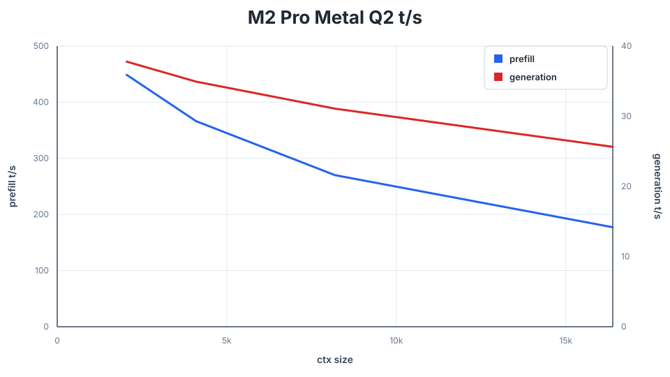

# Metal on Apple Silicon

[README](../README.md#start-here) | [Models](MODELS.md) | [SSD streaming](SSD_STREAMING.md)

## Build and run

Use an Apple Silicon M1 or newer Mac with macOS 11 or newer. Install Apple's
command-line developer tools if needed:

```sh
xcode-select --install
```

From the repository root:

```sh
make metal
./download_model.sh q2
./q36 --metal
```

The build produces the CLI, server, agent, benchmark, and evaluator. Metal
shaders compile at runtime. Run from the project tree and include `metal/`
with binary packages. Building another runtime overwrites the same executable
names; use separate worktrees to keep several builds.

## Memory

| Memory | Starting point |
| --- | --- |
| 8 GB | Qwen3.6 Q2 with SSD streaming and a smaller context |
| 16 GB | Resident Qwen3.6 Q2; leave room for context and the OS |

For an 8 GB Mac, start with the automatic cache budget:

```sh
./q36 --metal --ssd-streaming --ctx 4096
```

To reserve more memory for the OS or context, request a smaller expert cache:

```sh
./q36 --metal --ssd-streaming --ssd-streaming-cache-experts 512 --ctx 4096
```

A plain number requests expert slots; a value such as `1GB` requests a byte
budget. Both are capped to leave room for non-routed weights, context, and
scratch. Automatic sizing uses the device's `recommendedMaxWorkingSetSize`.
The startup report shows the effective allocation.

The cache holds routed experts in bounded shared Metal buffers. Mixed expert
sizes share padded slots; crossing into Q4 layers does not reset the cache.
Preloading reads real weights, and full-resident prefix layers consume their
actual bytes. These controls manage Metal allocations rather than relying on
macOS paging. See [SSD streaming](SSD_STREAMING.md) for the cache policy.

Dense Qwen3.8-27B weights must fit resident. Flash Next and vision execution
are unavailable on Metal. Multi-Mac inference has not been validated.

## Server and agent

Start the HTTP server:

```sh
./q36-server --metal --ctx 32768
```

On an 8 GB Mac:

```sh
./q36-server --metal --ssd-streaming --ssd-streaming-cache-experts 512 --ctx 4096
```

The API and client setup are described in [Server](SERVER.md),
[Clients](CLIENTS.md), and [UI](UI.md).

The native agent runs without an HTTP server:

```sh
./q36-agent --metal --chdir /path/to/project
```

For SSD streaming:

```sh
./q36-agent --metal --ssd-streaming --ssd-streaming-cache-experts 512
```

See [agent sessions](AGENT.md) for context defaults, tools, and saved sessions.

## Benchmarking and evaluation

Measure prefill and generation at successive context frontiers:

```sh
./q36-bench --metal --prompt-file tests/long_context_story_prompt.txt
```

Run the capability evaluation through SSD streaming:

```sh
./q36-eval --metal --ssd-streaming --trace /tmp/q36-eval-metal-ssd.txt
```

See [benchmarking](PERFORMANCE.md) for measurement rules and
[evaluation](TESTING.md#capability-evaluation) for the suites and controls.

## Regression checks

```sh
make test-metal
make test-metal-model
make test-server-live-metal
make test-server-batching-metal
```

The first target covers model-free tests and isolated GPU kernels. The others
need the release GGUF. The [release QA guide](../QA_BEFORE_RELEASES.md) also
covers SSD streaming, release builds, and physical 8 GB and M1 checks.

The build uses an M1 instruction baseline and a macOS 11 deployment target.
Newer residency and math APIs are selected only after runtime availability
checks. A successful build does not replace testing on the oldest supported
hardware and OS.

## Recorded measurements

The following single-process measurements used the default q2 GGUF fully
resident and the mixed q2-q4 GGUF with SSD streaming on a 16 GB M2 Pro with
macOS 26.5. The SSD run used the automatic 4240-expert (6.99 GiB) cache. Both
runs used [the story fixture](../tests/long_context_story_prompt.txt),
incremental prefill at doubling context frontiers, greedy decoding with 128
generated tokens per frontier, and Q8_0 K / Q4_0 V cache:

| Runtime | Quant | Expert residency | Prompt | Prefill | Generation |
| --- | ---: | --- | ---: | ---: | ---: |
| Metal | q2 | Full model resident | 2048 ctx | 448.75 t/s | 37.78 t/s |
| Metal | q2 | Full model resident | 4096 ctx | 366.19 t/s | 34.93 t/s |
| Metal | q2 | Full model resident | 8192 ctx | 270.02 t/s | 31.08 t/s |
| Metal | q2 | Full model resident | 16384 ctx | 177.21 t/s | 25.64 t/s |
| Metal SSD | q2-q4 | 4240 expert slots / 6.99 GiB | 4096 ctx | 58.74 t/s | 8.97 t/s |
| Metal SSD | q2-q4 | 4240 expert slots / 6.99 GiB | 8192 ctx | 55.32 t/s | 9.20 t/s |



These numbers show the expected capacity tradeoff, not a cross-machine
performance promise. Metal generation, prefill, and SSD behavior should be
remeasured on the oldest and smallest supported Mac before a release.
