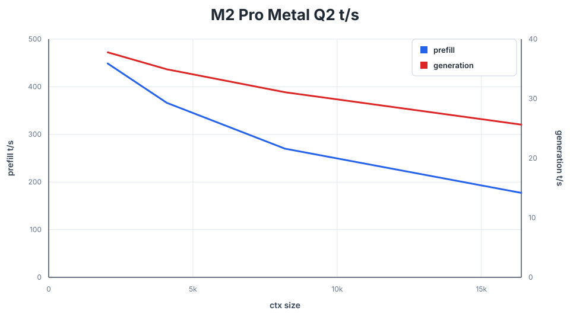
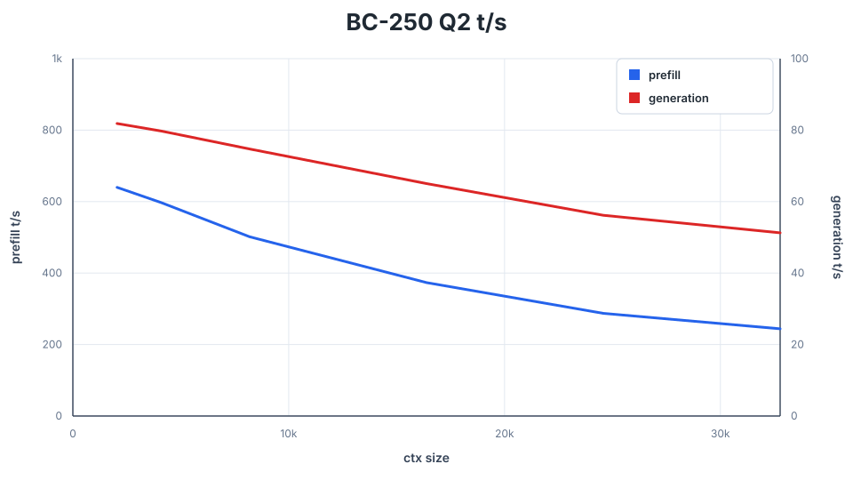

# Performance and Benchmarking

[README](../README.md#speed)

## Benchmark commands

`q36-bench` measures instantaneous prefill and generation throughput at
context frontiers instead of reporting one whole-run average. It loads the
model once, walks a fixed token sequence to frontiers such as 2048, 4096, and
6144, and uses incremental prefill so each row measures only the newly added
token interval. After each frontier it saves the live KV state to memory,
generates a fixed greedy non-EOS probe, restores the snapshot, and continues
prefill.

```sh
./q36-bench --vulkan --prompt-file tests/long_context_story_prompt.txt \
  --ctx-start 2048 --ctx-max 32768 --gen-tokens 128

./q36-bench --metal --prompt-file tests/long_context_story_prompt.txt \
  --ctx-start 2048 --ctx-max 32768 --gen-tokens 128
```
## BC-250 context sweeps

These recorded BC-250 sweeps use resident models, Q8_0 keys / Q4_0 values,
and 128 greedy generation tokens per frontier. Prefill measures the newly
added interval. MTP uses the embedded head with draft limit eight and
adaptive confidence (`--mtp-margin 0`). All rates are in tokens per second.

### Qwen3.6-35B-A3B

`gguf/Qwen3.6-35B-A3B-IQ2XXS-Q2K-Q8.gguf`

| Context | Prefill | Decode | MTP decode |
| ---: | ---: | ---: | ---: |
| 2,048 | 634.96 | 90.63 | 151.22 |
| 4,096 | 634.74 | 91.21 | 131.39 |
| 8,192 | 510.59 | 89.37 | 127.17 |
| 16,384 | 371.32 | 83.78 | 143.14 |
| 32,768 | 236.85 | 74.43 | 77.96 |
| 65,536 | 137.01 | 64.72 | 83.00 |


### Qwen3.8-27B

`gguf/Qwen3.8-27B-GSQ-RCO-IQ3_XXS-mtp.gguf`

| Context | Prefill | Decode | MTP decode |
| ---: | ---: | ---: | ---: |
| 2,048 | 207.64 | 27.07 | 36.44 |
| 4,096 | 194.88 | 26.94 | 40.31 |
| 8,192 | 169.60 | 26.22 | 34.53 |
| 16,384 | 135.21 | 25.11 | 37.49 |
| 32,768 | 95.43 | 22.06 | 30.61 |
| 65,536 | 59.48 | 20.18 | 25.32 |


### Qwen3.8-27B (IQ3_S)

`gguf/Qwen3.8-27B-UD-IQ3_S.gguf`

| Context | Prefill | Decode | MTP decode |
| ---: | ---: | ---: | ---: |
| 2,048 | 212.70 | 25.61 | 39.47 |
| 4,096 | 199.71 | 25.45 | 47.52 |
| 8,192 | 173.53 | 24.80 | 45.21 |
| 16,384 | 137.72 | 23.82 | 34.88 |
| 32,768 | 96.68 | 21.48 | 29.32 |
| 65,536 | 59.46 | 19.28 | 26.01 |


Recorded on 2026-10-25. The charts are in
[the sweep directory](../speed-bench/bc250-20261025). These are recorded
baselines, not a fresh benchmark of every commit.

## October 24 sweeps

The previous two resident model sweeps were recorded on 2026-10-24 at commit
`da0af84`, using Vulkan/RADV (Mesa 26.2.5). Raw CSVs and reproduction commands
are in [the benchmark directory](../speed-bench/bc250-20261024/README.md).

Each process allocates 65,665 tokens and measures frontiers from 2K through
64K, doubling each time. Prefill uses 1024-token chunks and measures only the
new interval. Decode generates 128 greedy tokens, excluding EOS. Snapshot
restore replays the prefix outside both timing windows. Models are warmed
before measurement, and only one model process runs at a time.

MTP uses the embedded head, draft ceiling eight, and adaptive confidence
(`--mtp-margin 0`). Its throughput depends on the continuation and acceptance
rate. Plain decode and MTP use separate sweeps over the same prompt. The
prefill column comes from the plain sweep.

The original story fixture has 34,392 tokens. These sweeps concatenate two
copies with two newlines between them to reach 64K. Results describe this
fixed workload and build.

## Metal measurements

The following single-process measurements used the default q2 GGUF fully
resident and the mixed q2-q4 GGUF with SSD streaming on a 16 GB M2 Pro with
macOS 26.5. The SSD run used the automatic 4240-expert (6.99 GiB) cache. Both
runs used [the story fixture](../tests/long_context_story_prompt.txt),
incremental prefill at doubling context frontiers, greedy decoding with 128 generated tokens per frontier, and
Q8_0 K / Q4_0 V cache:

| Runtime | Quant | Expert residency | Prompt | Prefill | Generation |
| --- | ---: | --- | ---: | ---: | ---: |
| Metal | q2 | Full model resident | 2048 ctx | 448.75 t/s | 37.78 t/s |
| Metal | q2 | Full model resident | 4096 ctx | 366.19 t/s | 34.93 t/s |
| Metal | q2 | Full model resident | 8192 ctx | 270.02 t/s | 31.08 t/s |
| Metal | q2 | Full model resident | 16384 ctx | 177.21 t/s | 25.64 t/s |
| Metal SSD | q2-q4 | 4240 expert slots / 6.99 GiB | 4096 ctx | 58.74 t/s | 8.97 t/s |
| Metal SSD | q2-q4 | 4240 expert slots / 6.99 GiB | 8192 ctx | 55.32 t/s | 9.20 t/s |



These numbers show the expected capacity tradeoff, not a cross-machine
performance promise. Metal generation, prefill, and SSD behavior should be
remeasured on the oldest and smallest supported Mac before a release.

## Historical BC-250 measurements

These are the earlier Qwen3.6 measurements retained from the README.
For the current models through 64K, see the [current sweeps](#bc-250-context-sweeps).

Benchmarks on a **BC-250** (40 CUs unlocked, Cyan-Skillfish Governor performance
mode at 500-2000 MHz, 85 °C thermal ceiling — a hot summer in Italy). Runs
use greedy decoding, `--gen-tokens 128`, the extended long-context story
prompt, and Q8_0 K / Q4_0 V cache. The q2 model is fully resident. The mixed
q2-q4 model uses SSD streaming with the automatic 5724-expert (4.72 GiB)
cache. Each row was measured in a separate process, with only one benchmark
process running at a time.

| Machine | Quant | Mode | Prompt | Prefill | Generation |
| --- | ---: | --- | ---: | ---: | ---: |
| BC-250 (40 CU) | q2 | Resident | 2048 ctx | 639.85 t/s | 81.85 t/s |
| BC-250 (40 CU) | q2 | Resident | 4096 ctx | 597.10 t/s | 79.74 t/s |
| BC-250 (40 CU) | q2 | Resident | 8192 ctx | 501.50 t/s | 74.72 t/s |
| BC-250 (40 CU) | q2 | Resident | 16384 ctx | 373.32 t/s | 65.04 t/s |
| BC-250 (40 CU) | q2 | Resident | 24576 ctx | 287.24 t/s | 56.17 t/s |
| BC-250 (40 CU) | q2 | Resident | 32768 ctx | 244.06 t/s | 51.26 t/s |
| BC-250 (40 CU) | q2-q4 | SSD streaming | 4096 ctx | 45.43 t/s | 14.52 t/s |
| BC-250 (40 CU) | q2-q4 | SSD streaming | 8192 ctx | 48.78 t/s | 13.98 t/s |



Use `q36-bench` for reproducible prefill and decode measurements. Release
builds also have a conservative BC-250 performance gate under
`make benchmark-gate`; record results on the same board and power state when
comparing changes.

## MTP measurements

### Qwen3.6 MoE

BC-250 resident Vulkan measurements with this head and Q8_0 K / Q4_0 V
cover prose, code, reasoning with thinking enabled, and structured output.
The table gives MTP speedups over ordinary decode in the same build:

| Workload | Greedy speedup | Sampled speedup |
| --- | ---: | ---: |
| Prose | 1.17–1.28× | 1.20–1.24× |
| Code | 1.21–1.99× | 1.48–1.58× |
| Reasoning | 1.40–1.50× | 1.51–1.60× |
| JSON | 1.39–1.50× | 1.52–1.62× |

These are serialized, warmed sweeps at 128, 2K, and 4K context with 192
generated tokens, draft ceiling eight, and margin zero. All 24 greedy cases
produce identical token sequences with MTP enabled or disabled. The 12
sampled cases use temperature 0.6 and seed 42; opportunistic MTP samples each
block boundary and uses a verified greedy tail, so its sampling distribution
differs from ordinary per-token sampling.

The current kernels improve MTP throughput by 19% geometrically over
`d5b4e4b`, with 12–27% gains across the greedy cases. Q8 verification shares
activation loads across output rows, shared experts verify multiple tokens
together, and eight-head attention reuses K/V loads. The MoE normalization
scratch adds 16 KiB; the model and head weights are unchanged. Measurements,
temperatures, dense-optimization audit, and validation are in
[the local speedup report](../tests/test-vectors/local/q36-moe-speed-20261023/README.md).
The [head-selection report](../tests/test-vectors/local/q36-moe-mtp-20261023/README.md)
records the earlier quantization comparisons.

### Dense Qwen3.8 historical comparison

MTP remains experimental. These BC-250 comparisons use the pushed
`e497fd7` build and the new implementation, 128 output tokens, and Q8_0 K /
Q4_0 V cache. Each sweep starts at 128 and extends through 2K and 4K.

Greedy generation:

| Context | Story, pushed → new t/s | C source, pushed → new t/s |
| ---: | ---: | ---: |
| 128 | 30.22 → 33.06 | 25.80 → 27.77 |
| 2048 | 32.34 → 34.08 | 30.01 → 30.35 |
| 3968 | 26.68 → 29.01 | 30.70 → 30.74 |
| 4096 | 31.96 → 32.45 | 30.57 → 34.52 |

Opportunistic generation at temperature 1, top-k 0, top-p 1 and min-p 0.05
(all cells are pushed → new t/s):

| Context | Story, seed 1 | Story, seed 42 | C source, seed 1 | C source, seed 42 |
| ---: | ---: | ---: | ---: | ---: |
| 128 | 26.91 → 35.56 | 29.26 → 29.33 | 23.36 → 29.01 | 26.57 → 29.02 |
| 2048 | 30.14 → 31.18 | 26.28 → 28.49 | 31.96 → 36.23 | 29.07 → 36.62 |
| 3968 | 26.64 → 30.16 | 25.45 → 30.03 | 29.12 → 32.08 | 28.35 → 31.12 |
| 4096 | 28.69 → 29.86 | 28.94 → 27.07 | 28.28 → 30.87 | 31.23 → 30.20 |

The regressed 2K code/seed-42 case reaches 36.62 t/s,
with 36.46 t/s in the final repeat. Additional pushed-build controls
measured 28.97 and 28.72 t/s; the older pre-regression build measured
30.94 and 31.03 t/s. Fresh 8K story/seed-1 generation changes from
30.74 to 32.63 t/s.

The largest sampled regression is 6.5% for story, seed 42, context 4096.
Sampled arms can produce different continuations, so these end-to-end
comparisons include continuation variation. A general 35 t/s rate or
attained hardware limit is not established. The paired IQ4 lookup is
independently 6–17% faster in warmed kernel measurements with identical
scalar outputs. It adds no tensor or weight buffers.

All greedy/sampled replay, quantized KV, checkpoint restore, scalar fallback,
MoE regression, separate-engine 8K and fresh 16-thread CPU/Vulkan checks
through top-64 pass. Every MTP replay has zero target-logit difference.
Maximum recorded benchmark temperature is 73°C.
Plain decoding remains the default. Commands, raw controls, rejected probes,
frozen sources and complete results are in
[the local benchmark artifacts](../tests/test-vectors/local/q38-mtp-20261021-v6/README.md).
